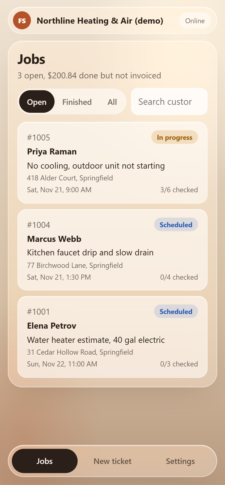
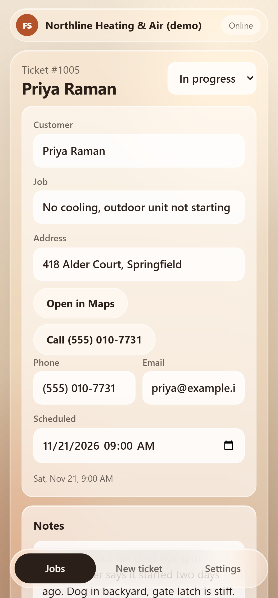
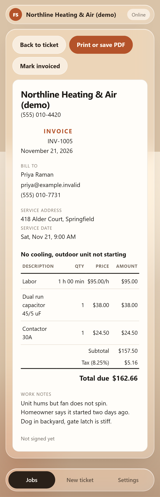

# field-service-pwa

[](https://github.com/chasebuilds/field-service-pwa/actions/workflows/ci.yml)

An installable, offline-first web app for small trades businesses (HVAC, plumbing, electrical). A tech opens a job ticket on a phone, works through a checklist, logs time and parts, takes photos, gets the customer's signature, and hands over a printable invoice. No account, no server. Everything is stored on the device.

**Live demo:** https://chasebuilds.github.io/field-service-pwa/ (invented customers, sample data loads on first visit; open it on a phone and use "Add to Home Screen" or the Install button in Settings)

| Jobs | Ticket | Invoice |
| --- | --- | --- |
|  |  |  |

## What it does

- **Job tickets:** customer, phone (tap to call), address (opens a maps link), schedule, notes, status.
- **Checklist** per job, with progress on the list.
- **Time on site:** clock in and out, several visits per ticket. Billable time rounds up to a set step (default 15 min) with an optional minimum.
- **Parts used** with quantity and unit price. Tax is on parts by default, with a switch to tax labor too.
- **Photos** from the camera, shrunk to 1280 px JPEG and kept in IndexedDB.
- **Customer signature** drawn on a canvas (finger or mouse).
- **Invoice** page with a print stylesheet. "Print or save PDF" uses the browser's print dialog, which includes Save as PDF.
- **Backup:** export everything (photos included) to one JSON file, import it on another device. Import keeps the newer copy of each ticket.
- **Works offline:** a service worker caches the app shell, so it loads with no signal. Data never leaves the device.

## Run it

```sh
npm install
npm run dev        # local dev server
npm test           # Vitest: totals, tax, time rounding, IndexedDB, backup
npm run lint && npm run typecheck
npm run e2e        # Playwright smoke test (builds and serves the app first)
npm run build      # production build in dist/
```

Set `VITE_DEMO=1` at build time to load demo data on first visit (the live demo does this). Set `BASE_PATH` when hosting under a sub-path.

## How it is built

TypeScript (strict), Vite, Preact, vite-plugin-pwa (Workbox precache). Money is integer cents and tax is in basis points, so totals never pick up float error. The logic (`src/lib/money.ts`, `time.ts`, `backup.ts`) has no UI dependency and is unit tested. The Playwright test loads the demo, edits a ticket, signs, opens the invoice, then reloads with the network off and checks the app still works.

```
src/lib/   money, time, db (IndexedDB), backup, demo data, photo resize
src/ui/    Preact screens: job list, ticket, invoice, settings, signature pad
e2e/       Playwright smoke test
tests/     Vitest unit tests
```

## LIMITATIONS

- Data lives in one browser on one device. Clearing site data or losing the phone loses it unless you exported a backup. There is no sync between devices.
- Browsers may evict IndexedDB on low storage if the app has not been installed or granted persistent storage. Install it and export backups regularly.
- The invoice is a print page, not a PDF file the app generates. Save as PDF depends on the browser's print dialog. There is no email or payment link.
- One user per device. No staff accounts, no customer database beyond what is typed into each ticket.
- Tax is a single flat rate. No per-item tax, discounts, or deposits.
- The signature is a drawn image with a timestamp. It is not a legally verified e-signature.
- The maps link opens a web search URL for the address. It does not check that the address exists.
- Tested in Chromium (Playwright, Pixel 7 profile). Not tested on iOS Safari or Firefox.
- Demo customers, addresses and the business are invented.

## License

MIT, Chase Builds.
